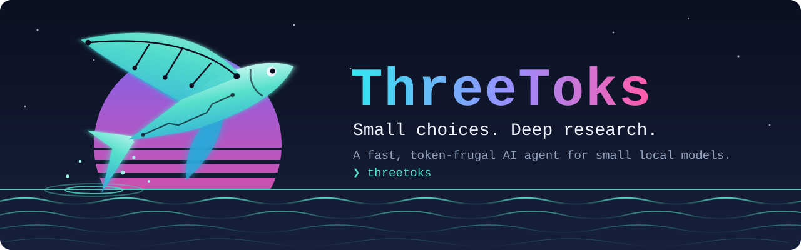

<p align="center">
  
</p>

<p align="center">
  <a href="LICENSE"></a>
  
  
  
</p>

<p align="center">
  <a href="#see-it-work">See it work</a> ·
  <a href="#quickstart">Quickstart</a> ·
  <a href="#agents">Agents</a> ·
  <a href="#the-config-screen">Config</a> ·
  <a href="#choose-a-model">Models</a> ·
  <a href="docs/DESIGN.md">Design</a> ·
  <a href="CONTRIBUTING.md">Contribute</a>
</p>

---

# ThreeToks

**ThreeToks is a small AI agent that runs on your own computer.**
It works with small language models. Small models are fast and use little memory.
But they make mistakes when they write long text.

So ThreeToks does not ask the model to write. It asks the model to **choose**.

Think of a ship. The code is the crew. It reads the charts, keeps the log, and steers.
The model is the lookout. At each fork in the sea, it only says one thing: *"This way."*

|  | A typical agent | ThreeToks |
|---|---|---|
| What the model does at each step | Writes a long plan | Picks **one number** from a menu |
| Tokens used per step | about 200 – 500 | about **1 – 3** |
| Time per step | about 15 – 30 seconds | about **0.3 seconds** |

> A *token* is a small piece of text, about three quarters of a word.
> Fewer tokens means a faster, cheaper step.

### Our goals

- **Main goal.** Make an agent that is *useful* even with a 1.5b model on a computer with less than 4 GB of memory. Each decision step must take less than one second.
- **Second goal** *(in progress).* Work with [Colibri](https://github.com/JustVugg/colibri/tree/main). Colibri runs the large glm-5.2 model from a fast SSD with less than 16 GB of RAM. See [Colibri](#colibri-work-in-progress).


## How it works

1. The code builds a **tree of decisions**. Each decision is a numbered menu.
2. The model answers with one number. This takes about 3 tokens.
3. The code does all the exact work: it reads pages, saves notes, and can undo a step.
4. To take notes, the model **points at numbered sentences**. It never rewrites them. So the code never invents text for a note.
5. A judge checks the final answer. If the answer is weak, the agent searches again.

The model only makes choices. Everything that must be exact is normal code.

## See it work

<p align="center">
  <a href="docs/animations/decision_tree.mp4">
    
  </a>
</p>

<p align="center">
  <em>Click the picture to open the full video (1080p, 60 fps, no sound, 19 seconds).</em>
</p>

<p align="center">
  <a href="docs/animations/decision_tree.png">Still image</a> ·
  <a href="docs/animations/decision_tree.py">Editable Manim source</a>
</p>

The video asks a simple question: **"Why do leaves change color in autumn?"** You can see these steps:

- A path moves through the tree and **routes** the question to the web agent.
- The agent **opens a search result**.
- It **copies numbered sentences** into notes that keep their source.
- A judge **rejects a weak answer**.
- The agent **searches again** with a new angle and the same notes.
- Three judges **approve** the new answer.

> **Please note.** The video is a script. It is not a live run, and it does not show a measured result.
> The menus and page text are shorter than real ones.
> The graph shows the chosen branches, not every branch.
> The judge comments are labels that we wrote. The model did not generate them.
> Real runs can end with no approved answer, for example when no source is available.
> The video leaves out recall, link-following, note curation, and error recovery. This keeps it short.

<details>
<summary>Render the video again</summary>

You only need this to change the video. You do not need it to run ThreeToks.

1. Install [Manim Community](https://docs.manim.community/en/stable/installation.html) 0.19.2 in a separate Python environment.
2. Run `python3 docs/animations/decision_tree.py`. This writes `docs/animations/decision_tree.mp4`. Temporary files stay in the ignored `docs/animations/.render/` folder.
3. Run `python3 docs/animations/make_preview.py`. This makes the small GIF that this page shows. GitHub cannot play an MP4 file inside a page.

The scene uses the Avenir Next font when it is available. Other systems use the font that Manim picks.

</details>


## Quickstart

You need three things: a model server, ThreeToks, and one command.

**1. Get a model.** Install [Ollama](https://ollama.com). Then download the default model:

```sh
ollama pull qwen3.5:4b
```

Other local servers also work. See [Choose a model](#choose-a-model).

**2. Install ThreeToks.** You need Python 3.10 or newer and [uv](https://docs.astral.sh/uv/).

```sh
git clone https://github.com/Fosowl/3toks.git
cd 3toks
uv tool install --editable ".[web]"
```

The `web` part adds web search. You can add more features. See [Optional features](#optional-features).

**3. Start it.**

```sh
threetoks
```

The first start opens the [config screen](#the-config-screen) and saves your settings. After that, you can chat.

You can also ask one question and exit:

```sh
python3 -m threetoks.cli "When was the Eiffel Tower completed?" --rounds 3
```

### Two optional boosters

Both make web research better.

- **SearXNG** is a private search engine that runs on your computer.
  Start it with `./start_search_engine.sh`. See [infra/searxng/README.md](infra/searxng/README.md).
  ThreeToks finds it by itself. Without it, ThreeToks searches Bing, then DuckDuckGo, and needs no setup.
  The Chrome mode below needs SearXNG.
- **Chrome mode** opens pages in a real Chrome window. Use it for pages that need JavaScript.
  Type `/browser plain` in the chat, or set `[browser] mode = plain` in the config.
  Use `/browser plain headless` to hide the window. Use `/browser http` to go back to the simple mode.
  This mode needs Chrome and the `browser` feature.

<details>
<summary>More about Chrome mode</summary>

- Chrome hides its automation switches. It keeps one profile in `~/.cache/threetoks/chrome-profile`. So cookies and solved bot checks stay between sessions.
- A site can show a bot check. A visible window then waits 45 seconds, so that you can solve it. A site that stays blocked is skipped until the session ends.
- `plain` mode works together with SearXNG. If no SearXNG answers, ThreeToks refuses to start in this mode and tells you to run `./start_search_engine.sh`.

</details>

## Optional features

The core of ThreeToks needs no extra package. Each feature below is an add-on.
Install an add-on to get the feature. Skip it, and ThreeToks still starts. It just leaves that feature out.

| Add-on | What you get | Packages it installs |
|---|---|---|
| `web` | The web research agent | curl_cffi, beautifulsoup4, markdownify |
| `browser` | Chrome page fetching (`/browser`) | selenium |
| `stt` | Voice input: speak, and it types | vosk, sounddevice |
| `tts` | Voice output: it speaks the answer | piper-tts, sounddevice, numpy |
| `voice` | Both `stt` and `tts` | — |
| `camera` | The `look` agent (webcam and a vision model) | opencv-python |
| `relay` | The `light` agent (a lamp on a Raspberry Pi only) | RPi.GPIO (ARM only) |

Pick the add-ons when you install:

```sh
uv tool install --editable ".[web,browser]"      # research
uv tool install --editable ".[web,voice,camera]" # voice assistant
uv tool install --editable ".[web,voice,relay]"  # Raspberry Pi
```

To work on the code itself, install into the project's own environment instead:

```sh
uv pip install -e ".[web,browser]"
```

## The config screen

Type `/config` in the chat, or run `threetoks config` in a terminal.
A control panel opens on the terminal's second screen. Your chat comes back when you leave.

Ten sections, named like parts of a harbor, hold every setting:

| Section | What it controls |
|---|---|
| **HELM** | The model and how to reach it |
| **NETS** | How web pages are fetched |
| **SONAR** | Where searches go |
| **DEPTH** | How deep the research goes |
| **DOCK** | Where your files live |
| **LOGBOOK** | What it remembers |
| **FORGE** | The code agent |
| **COMMS** | Talk and listen |
| **SCOPE** | The periscope camera |
| **BEACON** | The lighthouse relay |

| Key | Action |
|---|---|
| `↑` `↓` or `j` `k` | Move between settings |
| `←` `→` or `h` `l` or Space | Change a choice, a switch, or a number. Also steps through your Ollama models |
| Enter | Flip a switch, or open a text box for a text or path setting |
| Tab / Shift-Tab, `1`–`9`, `0` | Go to the next or previous section, or jump to one |
| `r` | Put the setting back to its default |
| `s` | Save |
| Esc | Leave. Press it twice to drop changes you did not save |

Each row says when a change starts to work:

- `live` — it works right away, when you leave the screen.
- `/voice on` — it works the next time you turn voice on.
- `restart` — it works the next time you start ThreeToks.

A small symbol at the end of a row is a live check. It tells you that Ollama answers, that the model is downloaded, that the API key is set, that SearXNG answers, or that a path exists.

When you save, ThreeToks changes only the lines you edited. Your own comments and the order of your keys stay as they are.
Without a real terminal (for example in a pipe, or with `TERM=dumb`), `/setup` asks the same questions one line at a time.

**Where ThreeToks looks for the config file**, in this order:

1. The path in `$THREETOKS_CONFIG`.
2. `./config.ini` in the current folder.
3. Your own file: `~/.config/threetoks/config.ini` on Linux and macOS (`$XDG_CONFIG_HOME` works too), or `%APPDATA%\threetoks\config.ini` on Windows.

### Command line

```sh
threetoks                         # chat
threetoks -m qwen3.6:27b          # chat with another model, this run only
threetoks -c ./other.ini          # use another config file
threetoks --no-color              # plain text (NO_COLOR also works)
threetoks config                  # open the config screen
threetoks config show             # show every setting; pink means "not the default"
threetoks config get llm.model
threetoks config set browser.mode plain
threetoks config path
threetoks doctor                  # check Ollama, model, keys, SearXNG, paths, add-ons
threetoks --version
```

Put the flags `-m`, `-c`, and `--no-color` *before* the subcommand.
`config set` checks your value like the screen does. It exits with code 2 for a bad key or value. It keeps the rest of the file as it was.
`doctor` exits with code 1 when a check fails, so you can use it in scripts.


## Agents

Every request goes through a **router**. The router shows the model a menu of agent names. Each name has a one-line description. The model picks one digit.
If the answer is not valid, ThreeToks uses the first agent in the list, `casual`.

| Agent | What it does | Details |
|---|---|---|
| `casual` | Small talk and quick replies | It ranks ready-made replies by shared keywords. An exact match needs **no** model call. If nothing fits, it writes a short free reply. |
| `web` | Answers questions with an internet search | It runs the [deep research](#deep-research) loop: search, read pages, follow links, take notes. |
| `files` | Answers questions about your files and folders | It stays inside `services.files_root`. It can run one short shell command, but only after a fixed block-list and a fresh safety judge both allow it. |
| `code` | "Where is X?", "Fix the bug in Y", "Work out Z from data.csv", "Write a script that…" | Four modes. See the list below. |
| `light` | "Turn on the light" | Needs a Raspberry Pi and the `relay` add-on. Clear phrases are matched by simple rules, with no model call. Other phrases cost one menu decision. |
| `look` | "What am I holding?" | Needs the `camera` add-on and a vision model (llava, qwen-vl, gpt-4o, claude, gemini, …). It takes one frame and makes one short vision decision. |

The `code` agent has four modes:

- **Navigate** finds code. It is free when your request names the symbol. Otherwise it shows a ranked short list.
- **Edit** changes one function. It shows a ranked list, then a menu with the function's source. The model writes **only the changed function**. Your repo's tests, or an import check, judge it. You then see a diff. **Nothing is written until you press `y`.**
- **Compute** runs a script once in `[files] root` and gives you the result.
- **Author** plans small functions and writes them one by one.

Code that the agent writes runs in a closed box: a temporary folder, and no API keys in its environment.

### Chat commands

| Command | What it does |
|---|---|
| `/help` | Show help |
| `/agents` | List the agents that are ready |
| `/deep N` | Set the number of research rounds |
| `/browser http\|plain [on-screen\|headless]` | Choose how pages are fetched |
| `/model NAME` | Change the model |
| `/voice on\|off\|debug` | Talk instead of typing. `debug` shows what the microphone hears, and why each gate dropped it |
| `/debug [on\|off\|full]` | Show the raw model answer and the reason it stopped. `full` also shows the whole prompt of each model call |
| `/config` | Open the config screen (`/setup` does the same) |
| `/quit` | Leave |

On a real terminal, the prompt remembers your history between sessions (`~/.config/threetoks/history`). You can edit a line with the arrow keys. Tab completes commands and their arguments: `/de<Tab>` gives `/deep`, and `/debug f<Tab>` gives `full`.

**Want a new agent?** It is one new module and one line in the registry. See [docs/AGENTS.md](docs/AGENTS.md).

## Choose a model

ThreeToks is **local first**. You need no account and no API key. Nothing leaves your computer.

| Provider | Set `provider =` | Mode |
|---|---|---|
| Ollama (default) | `ollama` | raw. This is the path we measured. |
| LM Studio | `lm-studio` | chat, at `localhost:1234` |
| Any local server with an OpenAI-style API (llama.cpp, vLLM, [Colibri](#colibri-work-in-progress), …) | `custom`, plus `api_base` | chat |

```ini
[llm]
provider = custom
api_base = http://127.0.0.1:8080/v1
model = my-local-model
```

If your local server needs a key, put it in the `LLM_API_KEY` environment variable. Otherwise you need no setup. ThreeToks has no SDK to install.

**Thinking models.** `[llm] disable_think = true` is the default. It starts each raw answer with an empty `<think></think>` block.
Thinking Qwen models need this. Without it, qwen3.8 answers every menu with nothing, and the router falls back to `casual`.
Set it to `false` to send the plain prompt.

**Debugging.** `/debug on` shows each raw answer and the reason it stopped. The reason `length` means that the node's token limit cut the reply before the model answered.

<details>
<summary>Cloud providers (optional)</summary>

You never need a cloud API. Everything above runs on your computer.
A cloud API is useful to try ThreeToks before you download a model, or to see how a larger model handles the same tree.
Set `[llm] provider`, then export the provider's API key:

| Provider | Set `provider =` | API key variable |
|---|---|---|
| Anthropic | `anthropic` | `ANTHROPIC_API_KEY` |
| OpenAI | `openai` | `OPENAI_API_KEY` |
| OpenRouter | `openrouter` | `OPENROUTER_API_KEY` |
| Together | `together` | `TOGETHER_API_KEY` |
| DeepSeek | `deepseek` | `DEEPSEEK_API_KEY` |
| Google (Gemini) | `google` | `GOOGLE_API_KEY` |

```ini
[llm]
provider = openrouter
model = qwen/qwen-2.5-7b-instruct
```

ThreeToks reads keys from the environment only. It never reads them from a config file.
Cloud providers use the same chat mode as the other chat providers in the table above. They work, but we do not recommend them.

</details>

## Colibri (work in progress)

[Colibri](https://github.com/JustVugg/colibri/tree/main) is an engine in the style of llama.cpp. It runs GLM-5.2 (744B parameters, int4) by streaming parts of the model from an SSD.
ThreeToks needs no new code for it. `coli serve` speaks the OpenAI chat API, so Colibri plugs in as a `custom` provider:

```ini
[llm]
provider = custom
api_base = http://127.0.0.1:8000/v1
model = glm-5.2     ; must match the --model-id of coli serve
send_seed = false   ; Colibri rejects the seed parameter
```

The two fit each other well:

- ThreeToks prompts only grow at the end. Colibri re-uses the start of the prompt in each slot. So each step reads only the new part, which is the slow part on an SSD engine.
- ThreeToks answers are 3 to 24 tokens. That is the easiest work for a decoder that makes 0.05 to 7 tokens per second.
- Colibri turns thinking off by default, reports token use, and makes one answer at a time. ThreeToks asks for one answer at a time too.

**Status: partly working.** Colibri rejects two standard request parameters with an HTTP 400 error:

- `seed` — **solved** on our side. `send_seed = false` leaves it out. The only cost is that the third retry (temperature 0.4) is no longer repeatable. All other tries use temperature 0, where a seed changes nothing. With this setting, menu decisions work from start to end against the Colibri server.
- `stop` — **still blocks.** Pick-many and short-text nodes send a `"\n"` stop sequence. Colibri answers: "Custom stop sequences are not supported yet." Every vertical uses short-text nodes, so full runs need `stop` support in Colibri. Cutting the text on the server side is enough, because our answers are only 3 to 24 tokens. A pull request is coming. (I just bought a new SSD, so that I can run Colibri and test it well.)

<details>
<summary>Limits that remain after it connects</summary>

- It runs in the same reduced chat mode as every other chat provider (see [Choose a model](#choose-a-model)). The prefill is a hint, not a fixed start. So a single-digit answer depends on how well GLM-5.2 follows instructions. A later option is the `/v1/completions` endpoint of Colibri (a raw prompt with no template), plus a GLM chat template in our family table.
- The HTTP timeout is fixed at 120 seconds. Colibri sends nothing until a non-streaming answer is complete. On a slow SSD, one decision can take longer. A timeout you can set is on the list.
- Colibri makes 0.05 to 7 tokens per second, depending on the hardware. A ThreeToks run spends only a few tokens per step, which is the point. But a run with many steps still takes minutes, not seconds. Sub-second steps stay a property of a local Ollama model.

</details>


## Voice, camera, and relay

Each feature turns on when you install its add-on. You do not change any code.
The settings live in the `[voice]`, `[camera]`, and `[relay]` sections of `config.ini`. The setup wizard writes them with commented defaults.

<details>
<summary><b>Voice input</b> — add-on <code>stt</code> (vosk, sounddevice)</summary>

Type `/voice on` to listen on the microphone. Each sentence passes three gates before an agent sees it:

1. A **junk list** removes the nonsense that Vosk invents from silence.
2. An **echo filter** compares the text with the last spoken answers. So the assistant never talks to itself.
3. A **one-token menu** asks the model: "meant for the assistant" or "background noise". This costs 1 token for each sentence that passes the free gates.

The Vosk model downloads by itself for `[voice] lang` (default `en-us`). Set `stt_model_path` to use a local model.

`/voice debug` shows each raw transcript, why a gate dropped it (empty, junk, or echo), and whether the menu judged it as meant for you or as noise.
If nothing shows up while you speak, check the microphone permission of your terminal in your operating system.

</details>

<details>
<summary><b>Voice output</b> — add-on <code>tts</code> (piper-tts, sounddevice, numpy)</summary>

ThreeToks speaks answers with a local Piper voice.
It does **not** download voice models for you. Get a `.onnx` file and its `.onnx.json` file from [rhasspy/piper-voices](https://huggingface.co/rhasspy/piper-voices). Keep them side by side. Then point `[voice] tts_model_path` at the `.onnx` file.

- The microphone is fully muted while ThreeToks speaks. It stays muted for `post_speak_delay` seconds more, so the echo can fade.
- The add-on `voice` installs both sides. Each side also works alone: voice in with text out, or text in with voice out.
- Set `[voice] enabled = true` to start the chat already listening.
- `/setup` has an optional voice step. It explains that you need *both* the `.onnx` file and its `.onnx.json` file, offers to open the Vosk and Piper pages, and asks again until a path works (or you keep your own).
- `/voice on` reads the saved config when it starts. So you do not need to restart. If voice is already on, run `/voice off` first.

</details>

<details>
<summary><b>Camera</b> — add-on <code>camera</code> (opencv-python)</summary>

The add-on registers the `look` agent when your model can see images.
One JPEG frame from the device `[camera] index` goes with one short decision.
An image costs many more tokens than a menu decision. So choose a vision model on purpose, for example `ollama pull llava` and then `/model llava`.

</details>

<details>
<summary><b>Relay</b> — add-on <code>relay</code> (RPi.GPIO, ARM only)</summary>

On a Raspberry Pi, the add-on registers the `light` agent. It drives an active-low relay board on BCM pin `[relay] pin` (default 17).
On any other computer, the add-on installs nothing, and the agent stays off.
The light agent is small on purpose. Use it as the **template for your own Raspberry Pi tools**. The steps (hardware module, agent, registration, packaging, tests) are in [docs/AGENTS.md](docs/AGENTS.md#hardware-agents-raspberry-pi-the-light-agent-is-a-template).

</details>

## Deep research

The `web` agent and `python3 -m threetoks.cli` use the same judged loop (`threetoks/research.py`):

1. **Research.** Run one research episode.
2. **Judge.** Check the answer. Simple checks come first and need no model call. They reject an empty answer, an answer that is only digits, and an answer with no notes.
3. **Ask the model.** Any other answer goes to a two-option menu: *"states the facts asked for"* or *"vague, off-topic, or not a real answer"*. We use words with meaning instead of a plain yes or no. In our tests, the 1.5b model's yes/no check was almost a coin flip. A menu with meaningful words works well.
4. **Try again if needed.** If the judge says no, the model proposes a **new search angle**. It must differ from every query already tried. Then another round runs on the **same notes**. So the evidence grows from round to round and does not start again.

`--rounds N` and `/deep N` set the maximum number of rounds.

**An honest note.** The answer is only as good as the search results.
The upstream engines of SearXNG, and the DuckDuckGo fallback, slow you down or give worse results when you use them a lot.
A failed run often means a bad results page, not a bad decision by the model.
A local SearXNG (see `infra/searxng/`) helps, but it does not remove the problem.

When search fails completely, ThreeToks says so. It does not make up an answer:

- If every search hop is blocked by a bot wall, the run ends with a **"search unavailable"** answer.
- If every page failed to open, the run ends with **"could not open any web page"**. Each failed page also shows as a `fetch` line in the ticker, with the reason. The command-line tool exits with a non-zero code. ThreeToks does not write an answer from an empty note store.

## Under the hood

- **Architecture.** [docs/DESIGN.md](docs/DESIGN.md) explains the decision nodes, the append-only prompt layout, the model and backend plan, the ladder that recovers from wrong picks, and the layout of the repository.
- **New agents.** [docs/AGENTS.md](docs/AGENTS.md).
- **Default model.** `qwen3.5:4b` through Ollama, for every node. `deepseek-r1:1.5b` also works (ThreeToks switches off its thinking in raw mode), but it is not the default.
- **Experiments.** The folders in `spikes/` hold tests of the code agent: E7 code routing, E8 the edit vertical, E9 code retrieval. The Phase 0 results (E1 to E4) are in [docs/DESIGN.md §11](docs/DESIGN.md).

### What the experiments showed

Phase 0 chose the default model and the shape of the decision nodes from **measured behavior**, not from guesses:

- `qwen3.5:4b` picks the right menu option **76.7%** of the time. `deepseek-r1:1.5b` gets only 23 – 26%. So it cannot be the policy model.
- The "escape" option must be the **last numbered choice**, not the digit `0`. Tiny models almost never write a `0`.
- A retry ladder (a new temperature and a shuffled menu) fixes about **half** of the first-try failures.

Details and open questions: [docs/DESIGN.md §11](docs/DESIGN.md). Each folder in `spikes/` has its own `REPORT.md`.

## Tests

```sh
python3 -m unittest discover -s tests
```

## Contributing

Read [CONTRIBUTING.md](CONTRIBUTING.md) first. It covers setup, how we write tests, and the design rules that you must know before you change the core.
Send security problems to [SECURITY.md](SECURITY.md), **not** to a public issue.
Everyone who takes part follows the [Code of Conduct](CODE_OF_CONDUCT.md).

<details>
<summary>Words used in this file</summary>

| Word | Meaning |
|---|---|
| **Agent** | A helper that does one kind of job, such as web research or code. |
| **Model** | The AI that makes the choices. Here it is a small language model. |
| **Local** | Runs on your own computer. Your data does not leave it. |
| **Token** | A small piece of text, about three quarters of a word. |
| **Prompt** | The text that you send to the model. |
| **Menu** | A numbered list of choices. The model answers with one number. |
| **Router** | The first menu. It sends your request to the right agent. |
| **Judge** | A check on an answer. It decides if the answer is good enough. |
| **Ollama** | A free program that runs models on your computer. |
| **SearXNG** | A private search engine that you can run yourself. |
| **Add-on** | An optional part. You install it to get one feature. |

</details>


<p align="center">
  <b>Small choices. Deep research.</b> · Released under the <a href="LICENSE">MIT License</a>
</p>
